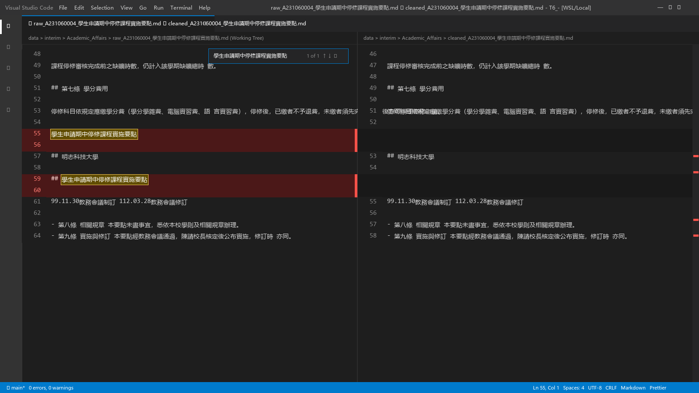
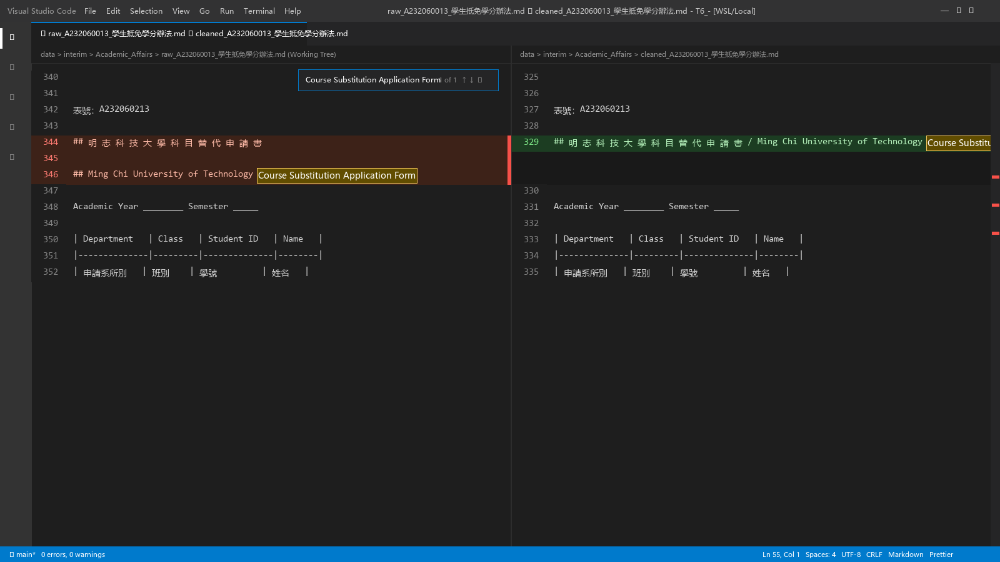
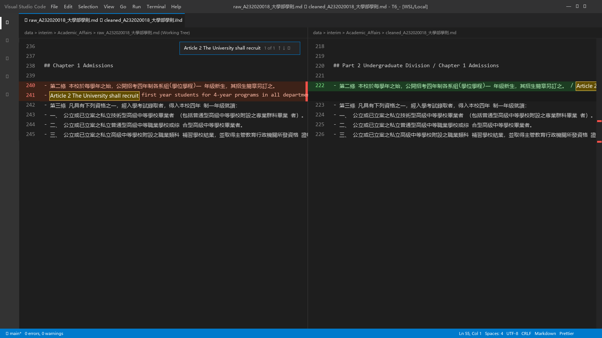
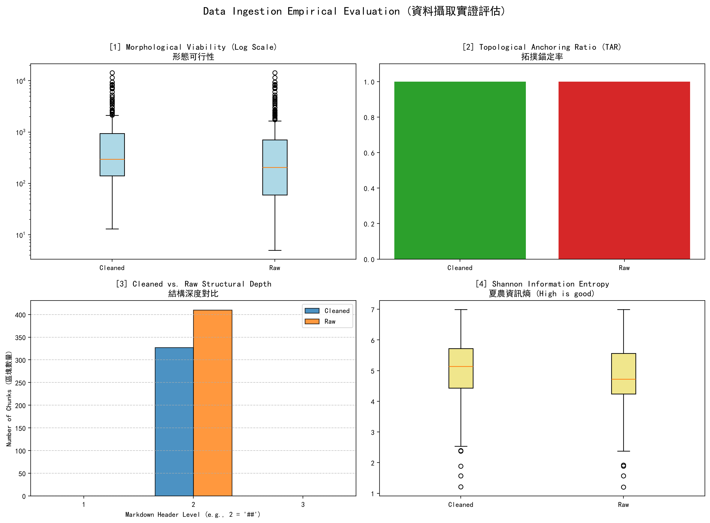

# 資料前處理報告 (Data Preparation Report)

- **學號 / 姓名**：U12627901 / 黃章盛
- **專案名稱**：T6_-
- **完成的任務**：1-A header removal, 1-B bilingual heading merge, 1-C bilingual clause merge.
- **Reproduction**: The saved Docling Markdown was reused. Cleaning, chunking, metrics, and the dashboard were rerun. This was not a new PDF conversion.
- **Assessment instructions**: Follow the teacher's [Week 09 requirements](reports/instructions/week09_midterm.md). Midterm submission is by Commit & Push; no Git Tag or Release is required.

## 1. 資料集概覽 (Dataset Overview)

| 類別 (Cluster) | PDF 數量 | 清洗前 chunk 數 | 清洗後 chunk 數 |
|---|---|---|---|
| Academic_Affairs | 3 | 96 | 64 |
| Library_Information | 3 | 248 | 209 |
| Student_Affairs | 3 | 66 | 54 |
| **合計** | **9** | **410** | **327** |

The number of chunks fell from 410 to 327, a drop of 83 (about 20.2%). Tasks 1-A and 1-B remove or join `##` headings, so they reduce the number of boundaries used by `chunking_regex = r'\n(?=##\s)'`. Task 1-C joins list text without changing the heading boundaries in this dataset, so it does not change the chunk count here.

## 2. 清洗步驟 (Cleaning Steps)

The examples below come from real files in `data/interim/`, not the classroom test passages. Each task is documented below with its exact filename, search keyword, explanation, and a VS Code Compare image showing the relevant line changes. The current images were visually checked against the described examples.

### 2.1 任務 1-A：頁首頁尾溢出清除

- 檔名：`Academic_Affairs/raw_A231060004_學生申請期中停修課程實施要點.md` and the matching `cleaned_` file.
- 搜尋的文字：`學生申請期中停修課程實施要點`, near raw line 55, after Article 7's fee paragraph.
- 比較圖：
- 改變了什麼：The repeated regulation title after the fee paragraph was removed. The fee paragraph and following text remain.
- 這對之後的問答檢索有什麼幫助：Removing a repeated page title reduces noise and can prevent false chunk boundaries when the title has a `##` marker.
- 有沒有改錯：Yes, the rule can also remove a useful title. In the same file, raw line 7 is the regulation name on the cover. It is removed too. The rule checks the text of the line but does not check whether it is a page header or the first document title. The regulation name should also be kept in document metadata.

### 2.2 任務 1-B：雙語標題合併

- 檔名：`Academic_Affairs/raw_A232060013_學生抵免學分辦法.md` and the matching `cleaned_` file.
- 搜尋的文字：`Course Substitution Application Form`; raw lines 344–346, cleaned line 329.
- 比較圖：
- 改變了什麼：The Chinese course substitution form heading and its English heading were joined into one line with ` / `. Only the first `##` marker remains.
- 這對之後的問答檢索有什麼幫助：Both language versions stay with the same form content. The English heading no longer starts a separate chunk.
- 有沒有改錯：Yes. In `cleaned_A232020018_大學部學則.md`, line 220 contains `## Part 2 Undergraduate Division / Chapter 1 Admissions`. These are different levels of the document, not a translation pair. Task 1-B merged them because they were adjacent headings. Section 4 gives the evidence and a possible fix.

### 2.3 任務 1-C：雙語條文合併

- 檔名：`Academic_Affairs/raw_A232020018_大學部學則.md` and the matching `cleaned_` file.
- 搜尋的文字：`Article 2 The University shall recruit`; raw lines 240–241, cleaned line 222.
- 比較圖：
- 改變了什麼：The Chinese Article 2 text and the English Article 2 text were joined with ` / `. Their content was kept.
- 這對之後的問答檢索有什麼幫助：The Chinese and English versions stay next to each other. A later system that splits list items is less likely to separate this translation pair. In the current heading-based splitter, they were already in the same chunk, so Task 1-C does not reduce the chunk count here.
- 有沒有改錯：Yes. In the same cleaned file, line 214 is `<!-- formula-not-decoded --> / Article 1 The Academic Regulations for Undergraduate Studies`. The rule joined an unresolved conversion marker to an English clause. It only checks that the second item starts with an English letter; it does not check that the previous text is a valid Chinese clause. A passing classroom assertion does not prove that all real text was merged correctly.

## 3. 評估指標與 AI 解讀查證 (Metrics & Verifying the AI's Interpretation)

### 3.1 指標數據表

Source: the regenerated `metrics.json` and the outputs of section 6 in `01_Data_Ingestion.ipynb`.

| 指標 | Raw | Cleaned (你的) | Cleaned (參考值) |
|---|---|---|---|
| [1] Median Length | 205.0 | 297.0 | 270.5 |
| [2] TAR | 100.00% | 100.00% | 100.00% |
| [3] SDV (optional) | 0.00 | 0.00 | 0.00 |
| [4] Median Entropy (optional) | 4.72 | 5.14 | 5.06 |



Reference source: The teacher's metrics photo supplied by the user, saved as [teacher_metrics_reference.jpg](reports/figures/teacher_metrics_reference.jpg). The cleaned reference values are median length 270.5, TAR 1.0 (100%), SDV 0.0, and entropy 5.0623172389748445 (rounded to 5.06 above).

Reference comparison: My results do not fully match the teacher's reference: TAR and SDV match, but median length is 297 rather than 270.5, and median entropy is about 5.14 rather than 5.06. Different cleaning or chunk boundaries may explain this. Sections 2 and 4 show incorrect merges in my files, but without the teacher's code and data I cannot confirm the exact cause.

The teacher's raw median entropy is 4.722966879142464; mine is 4.719958679606001. Both round to 4.72, but the exact values differ slightly. This suggests the raw text or chunks may also differ, so the cleaned differences cannot be attributed only to the cleaning rules. My own values in `metrics.json` and the dashboard have been kept unchanged.


### 3.2 AI 的解讀

- 使用的 AI 工具：OpenAI Codex.
- Input: `reports/figures/dashboard.png`, checked together with the exact values in `metrics.json`.
- Full AI interpretation:

```text
1. The median chunk length rises from 205 to 297 characters. This is consistent with joining headings and removing some short header chunks. The length plot still has many large outliers, so cleaning has not solved the long-chunk problem.
2. TAR is 100% before and after cleaning. All chunks start with a heading marker according to the code's check. This does not prove that the headings are correct or that every chunk has useful content.
3. All starting headings are at level 2, so the depth variance is 0 in both datasets. The chart does not show a restored hierarchy between parts and chapters.
4. Median character entropy rises from about 4.72 to 5.14 bits per character. This shows a change in character diversity. It does not prove better answers or better retrieval. Tables, repeated text, and short form numbers still need inspection.
Overall, the cleaning reduces the number of chunks and keeps more text together. Some errors remain, including incorrect heading merges and large form tables. Retrieval quality still needs to be tested with real questions.
```

### 3.3 你的查證 (至少兩點)

The following checks were performed with Codex against the local files and code. They are recorded as AI-assisted checks, not as independent manual tests by the student.

**查證 1**

- AI 的說法：The median chunk length rises from 205 to 297 characters.
- 我查了什麼：All 18 raw and cleaned JSON files in `data/processed/` were read again. There are 410 raw chunks and 327 cleaned chunks. The median of `len(record["text"])` was calculated for each group and compared with `metrics.json` and `get_lengths()` in notebook section 6.
- 結論：Correct. The results are 205 and 297 characters. This supports the numeric claim, but it does not show that every chunk became longer or that retrieval improved.

**查證 2**

- AI 的說法：TAR is 100%, but this does not prove that every chunk is useful.
- 我查了什麼：The notebook's `get_tar()` checks only `re.match(r'^\s*#+', record["text"])`. All 410 raw and 327 cleaned chunks pass this check. The assigned cleaned chunk at position 10 in `Academic_Affairs/cleaned_A231060004_學生申請期中停修課程實施要點_processed.json` contains only `## 表單號碼：A031060104`.
- 結論：Correct. A chunk with only a form number still counts as anchored. TAR alone cannot measure whether a chunk answers a question or keeps the right context.

**查證 3 (optional)**

- AI 的說法：All starting headings are at level 2, so the depth variance is 0.
- 我查了什麼：The leading `#` characters were counted again for every raw and cleaned chunk, following `get_depths()` in section 6.
- 結論：Correct. All 410 raw and 327 cleaned starting headings have depth 2. This metric does not confirm that the original PDF hierarchy was recovered.

### 3.4 實際證據：你被指定的 chunk

- **SEED**：1106
- **學號**：U12627901

**(a) 很長的 chunk**

- 資料檔 (JSON)：`data/processed/Academic_Affairs/cleaned_A232060013_學生抵免學分辦法_processed.json`　位置：第 25 個 (從 0 開始數)　長度：4367 字元　驗證碼：`7c7d73b6`
- 閱讀用檔案 (`.md`)：`data/interim/Academic_Affairs/cleaned_A232060013_學生抵免學分辦法.md`　從第 277 行開始
- 前 3 行內容 (包含第 2 行的空白行)：

```text
## 明 志 科 技 大 學 學 分 抵 免 申 請 書 Ming Chi University of Technology Credit Transfer Application Form

- [ ] □博士班 □碩士班 □四技部
```

- 這是什麼樣的文字？為什麼會這麼長？This is a credit transfer application form. It has student details, course information, review options, and approval fields. The table contains repeated text, many spaces, and Markdown table symbols. The code splits text only at `##` headings, so the whole table stays in one chunk. This makes the chunk 4367 characters long.
- 之後做問答檢索時，這麼長的 chunk 可能造成什麼問題？The search system may return a lot of repeated text that is not needed for the question. This uses more space in the model's input and may make the useful information harder to find. If the system has a small input limit, it may cut off part of the table. A possible fix is to remove extra spaces and split the table into smaller parts. Each part should keep the form title and column names.

**(b) 資訊熵很低的 chunk**

- 資料檔 (JSON)：`data/processed/Academic_Affairs/cleaned_A231060004_學生申請期中停修課程實施要點_processed.json`　位置：第 10 個 (從 0 開始數)　資訊熵：3.50 bits/字元　驗證碼：`ce165359`
- 閱讀用檔案 (`.md`)：`data/interim/Academic_Affairs/cleaned_A231060004_學生申請期中停修課程實施要點.md`　從第 73 行開始
- 內容 (完整，共 18 字元)：

```text
## 表單號碼：A031060104
```

- 為什麼它的資訊熵這麼低？它對問答檢索有用嗎？This chunk only contains a form number. It has few different characters, and some characters appear more than once. Its character entropy is about 3.50 bits per character. This is higher than the long chunk's entropy of 3.06. The code selects the two chunks from different groups: this one comes from the 20 chunks with the lowest entropy, so it does not have to be the lowest of all. The form number is useful when someone searches for that exact form. However, this chunk alone cannot answer questions about course withdrawal rules or steps. We could store the number as metadata, or keep it with the form text. Low entropy does not always mean the text is useless.

## 4. 一個尚未解決的問題 (One Remaining Problem)

- **檔名**：`data/interim/Academic_Affairs/cleaned_A232020018_大學部學則.md`
- **從第 220 行開始**；**標題**：`## Part 2 Undergraduate Division / Chapter 1 Admissions`
- **JSON location**：`data/processed/Academic_Affairs/cleaned_A232020018_大學部學則_processed.json`, position 5 (zero-based). This is different from both assigned chunks in section 3.4.
- **我是怎麼找到的**：Codex compared the real raw and cleaned files and searched for `Part 2 Undergraduate Division`. The raw file has two separate headings at lines 236 and 238.
- **問題 chunk (部分內容)**：

```text
## Part 2 Undergraduate Division / Chapter 1 Admissions

- 第二條 本校於每學年之始，公開招考四年制各系組(學位學程)一 年級新生，其招生簡章另訂之。 / Article 2 The University shall recruit first year students for 4-year programs in all departments (Bachelor Program) at the beginning of each academic year upon approval of the proposed admission procedures. The admission brochure shall be stipulated separately.
```

- **問題是什麼**：Task 1-B joined a part heading and a chapter heading. They are different document levels, not Chinese and English versions of the same heading.
- **可能的原因**：Docling exported both headings as `##`. The cleaning regex then merged any adjacent headings without checking their language, meaning, or section type.
- **具體的修正方法**：Before merging, identify labels such as Part, Chapter, Article, 篇, 章, and 條. Keep different section levels separate, and store their parent-child relationship as metadata. Only merge confirmed translations of the same heading. Add a counterexample using these two English headings. This is a proposed fix; the current cleaning rules were kept unchanged for the reported experiment.
- **對問答檢索的影響**：The current result loses the clear boundary between the part and the chapter. A retrieval system may return a broad mixed chunk or give the wrong section label. Keeping the hierarchy can help it return the right section and citation.

## 5. AI 協作 (AI Collaboration)

- The AI collaboration record is in [`AI_USAGE.md`](AI_USAGE.md), under Week 04 / 08 and Week 09.
- My main lesson from this AI-assisted review is that a passing assertion or a high metric is not enough. The sample assertions passed, but real files still contain incorrect merges. AI claims should be checked with exact files, line numbers, and the code used to calculate each metric. I should also keep the teacher's reference values separate from my own results.
